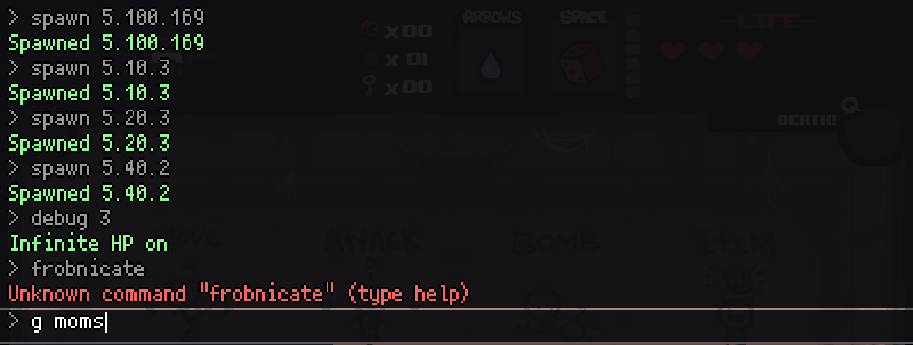
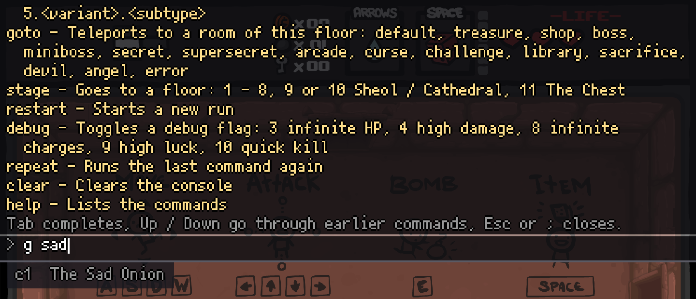
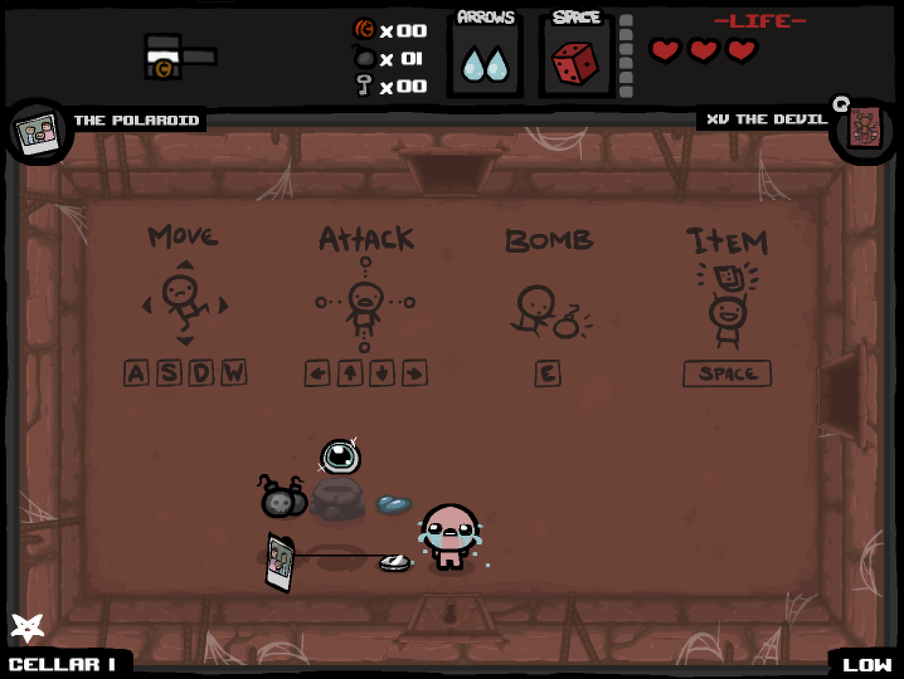

# Debug Console for The Binding of Isaac (Flash)

**Press `;` during a run to open the console!**

The debug console of Rebirth / Repentance, recreated for the original Flash game
([The Binding of Isaac](https://store.steampowered.com/app/113200/The_Binding_of_Isaac/),
including Wrath of the Lamb/Eternal DLC). Give yourself items, spawn enemies and pickups, teleport to any room,
skip to any floor and toggle debug cheats.

Built the same way as [EID Flash](https://github.com/tomandesMSH/Flash-EID) and
[Stats HUD](https://github.com/tomandesMSH/FlashTBoI-StatsHUD): a patcher builds the modded game from your own copy,
and it works on its own or together with the other mods.

## Screenshots
| | |
|---|---|
|  |  |

## Commands

| Command | What it does |
|---|---|
| `giveitem` / `g` `<c#\|t#\|k#\|p#\|name>` | Gives a collectible (`c12`), trinket (`t47`), card (`k1`) or pill color (`p3`), by id or name: `g sad onion`, `giveitem the polaroid` |
| `remove` / `r` `<c#\|t#\|name>` | Takes a collectible or trinket away |
| `spawn <type>[.<variant>[.<subtype>]]` | Spawns next to Isaac. Enemies by type (`spawn 10` Gaper, `spawn 20` Monstro); pickups as in Repentance: `5.10` heart, `5.20` coin, `5.30` key, `5.40` bomb, `5.50` chest, `5.60` locked chest, `5.70` pill, `5.100.<id>` collectible, `5.300.<id>` card, `5.350.<id>` trinket (`spawn 5.10.3` soul heart, `spawn 5.100.12` Magic Mushroom) |
| `goto s.<room>` / `goto <number>` | Teleports to a room of this floor: `default`, `treasure`, `shop`, `boss`, `miniboss`, `secret`, `supersecret`, `arcade`, `curse`, `challenge`, `library`, `sacrifice`, `devil`, `angel`, `error` |
| `stage <1 - 11>` | Goes to a floor: 1 - 8 (Basement to Womb), 9 or 10 Sheol / Cathedral, 11 The Chest |
| `restart` | Starts a new run |
| `debug <flag>` | Toggles: 3 infinite HP, 4 high damage (+40), 8 infinite item charges, 9 high luck (+50), 10 quick kill |
| `repeat [times]` | Runs the last command again |
| `clear`, `help [command]` | Clears the console, lists the commands |

**Tab** completes commands, item names, rooms and floors (press again for the next match). **Up / Down** go through
earlier commands. **Esc** or **`;`** closes the console. The game is paused while the console is open.

Ids are the same as in Rebirth / Repentance for collectibles, trinkets and cards. Pills are given by color (1 - 6):
in the Flash game a pill color only gets its effect when the first pill of that color is taken.

## Installation
No game files are distributed. The patcher builds the modded game from your own copy:

1. Download `Debug_Console_Patcher.exe` from the [latest release](https://github.com/tomandesMSH/FlashTBoI-DebugConsole/releases/latest)
   and put it in the folder where you want to keep the game.
2. Double-click it. A game window appears for a few seconds while it reads your game, then the patcher creates a
   `Debug Console` folder next to itself (and downloads Adobe's Flash Player 32 projector into it).
3. At the end it shows a launch option (and copies it to your clipboard). Paste it into Steam: right-click
   The Binding of Isaac > Properties > General > **Launch Options**. Or start the game with
   `Debug Console\Debug Console.exe`.

**With other mods:** use the [TBoI Flash Mods](https://github.com/tomandesMSH/FlashTBoI-Mods) installer and tick the
mods you want, or run the patcher on another mod's result:

    Debug_Console_Patcher.exe --swf "EID Flash\isaac_eid.swf"

Prefer not to run an exe? The zip has the plain Python script (`python debug_console_patcher.py --get-projector`).

Details: [`flash/patcher/README.txt`](flash/patcher/README.txt). Development and technical notes:
[`flash/README.md`](flash/README.md).

## Note
The modded game uses the same save as the Steam version. Giving items with the console doesn't unlock anything, but
what you do afterwards counts as usual (e.g. beating a boss on a floor you skipped to).

## Credits
See [CREDITS.md](CREDITS.md).
